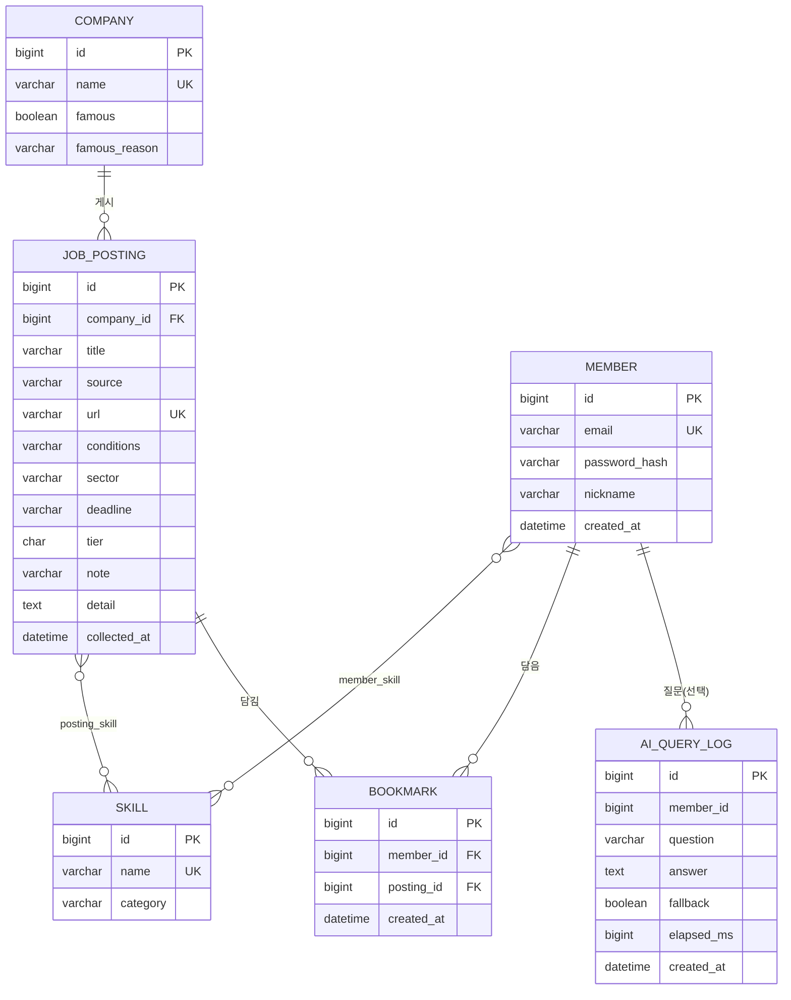
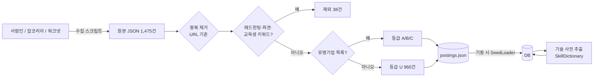
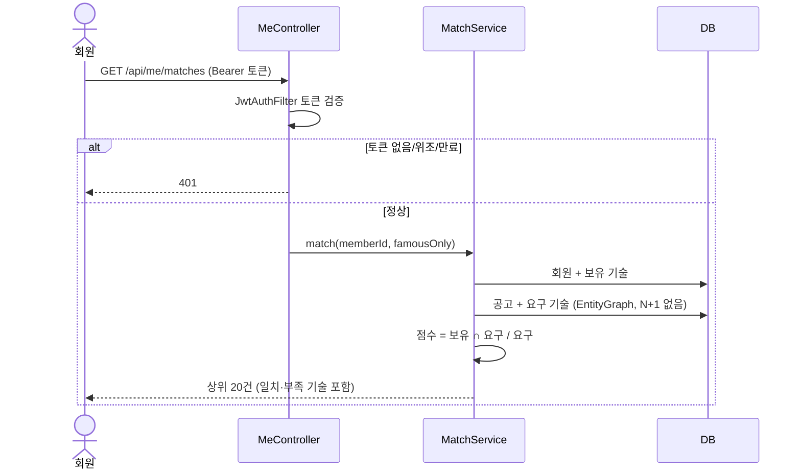
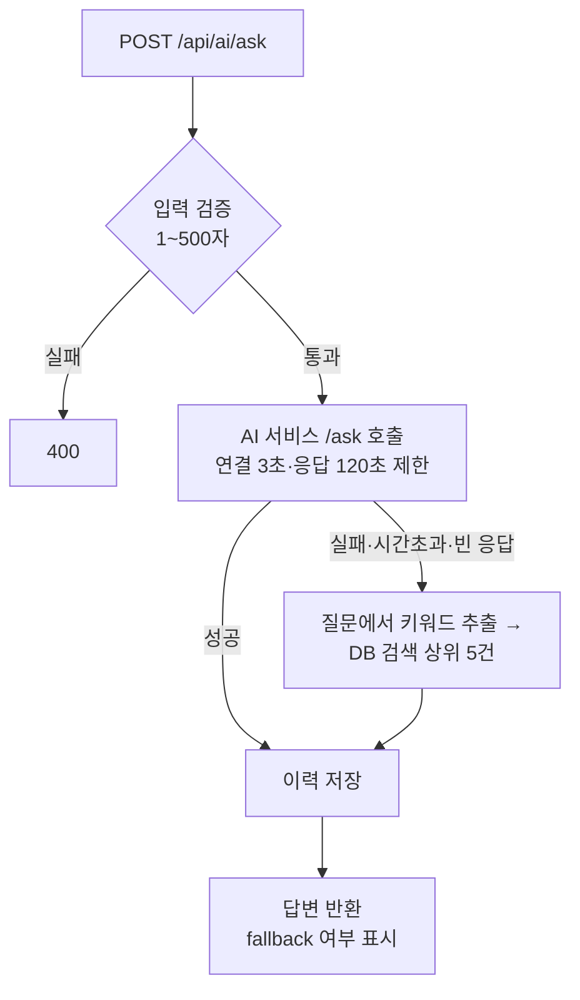

# JobFit 데이터 정의서

## 1. ERD

## 2. 테이블 정의

### company
| 컬럼 | 타입 | NULL | 설명 |
|---|---|---|---|
| id | BIGINT PK | N | 자동 증가 |
| name | VARCHAR(120) UK | N | 기업명 |
| famous | BOOLEAN | N | 유명기업 선별 목록 포함 여부 |
| famous_reason | VARCHAR(120) | Y | 선정 근거(예: "카카오 계열") |

### job_posting
| 컬럼 | 타입 | NULL | 설명 |
|---|---|---|---|
| id | BIGINT PK | N | |
| company_id | BIGINT FK | N | company.id, 인덱스 |
| title | VARCHAR(300) | N | 공고 제목 |
| source | VARCHAR(10) | N | SARAMIN / JOBKOREA / WORK24 |
| url | VARCHAR(300) UK | N | 원문 링크. 중복 방지 키 |
| conditions | VARCHAR(300) | Y | 지역·경력·학력·고용형태 |
| sector | VARCHAR(300) | Y | 직무 키워드 |
| deadline | VARCHAR(40) | Y | 마감 표기(원문 그대로) |
| tier | CHAR(1) | N | A 추천 / B 종합공채 / C 비해당 / U 그 외. 인덱스 |
| note | VARCHAR(200) | Y | 비고(인턴·계약직·경력 명시 등) |
| detail | TEXT | Y | 상세 본문(일부 공고만 수집) |
| collected_at | DATETIME | N | 수집 시각 |

### skill / posting_skill / member_skill
- skill(id, name UK, category): 기술 사전. 카테고리는 언어·백엔드·데이터·프론트·인프라·AI·품질.
- posting_skill(posting_id, skill_id), member_skill(member_id, skill_id): 다대다 연결 테이블.

### member
| 컬럼 | 타입 | 설명 |
|---|---|---|
| email | VARCHAR(120) UK | 소문자 정규화 후 저장 |
| password_hash | VARCHAR(100) | BCrypt. 평문 저장 안 함 |
| nickname | VARCHAR(30) | |

### bookmark
(member_id, posting_id) 유니크 → 같은 공고를 두 번 담을 수 없다.

### ai_query_log
질문·답변·대체응답 여부·소요시간 기록. member_id는 비로그인이면 NULL(외래키 아님).

## 3. 데이터 흐름도

## 4. 순서도 — 적합도 매칭

## 5. 순서도 — AI 질문 (장애 대체)

